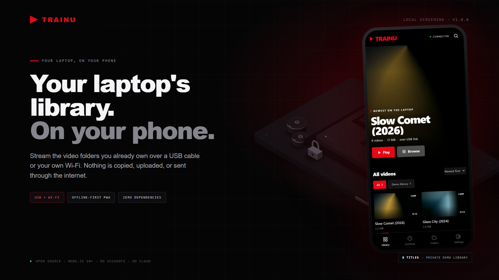
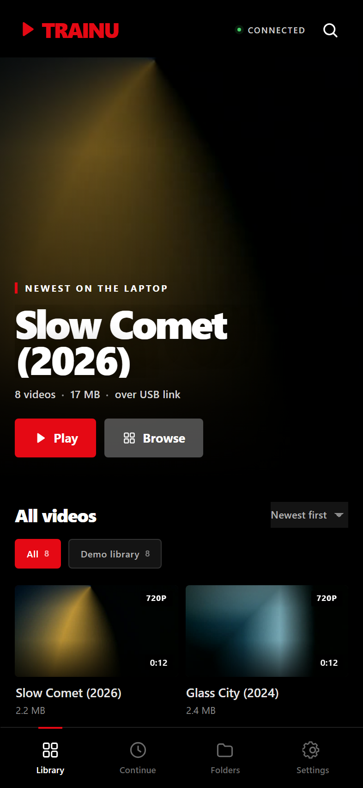
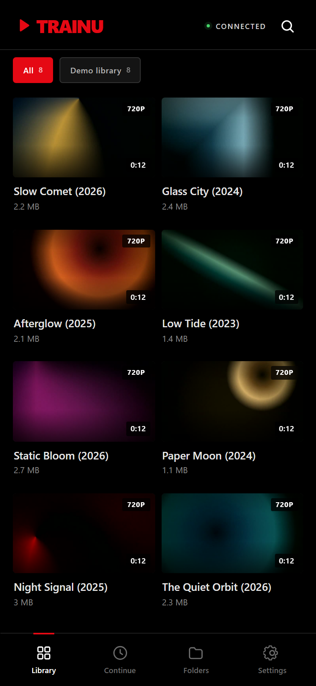
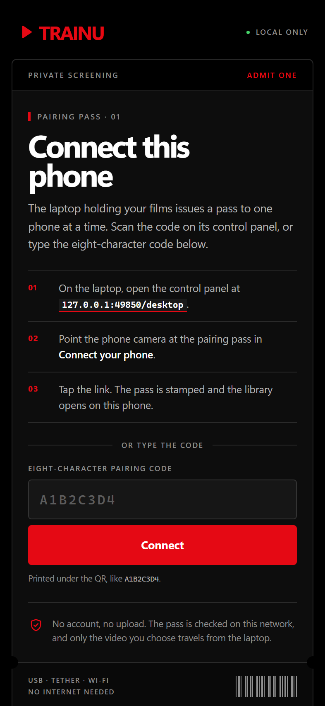
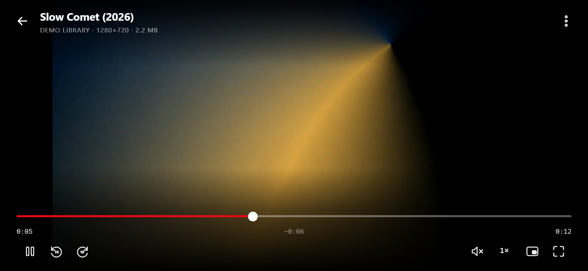
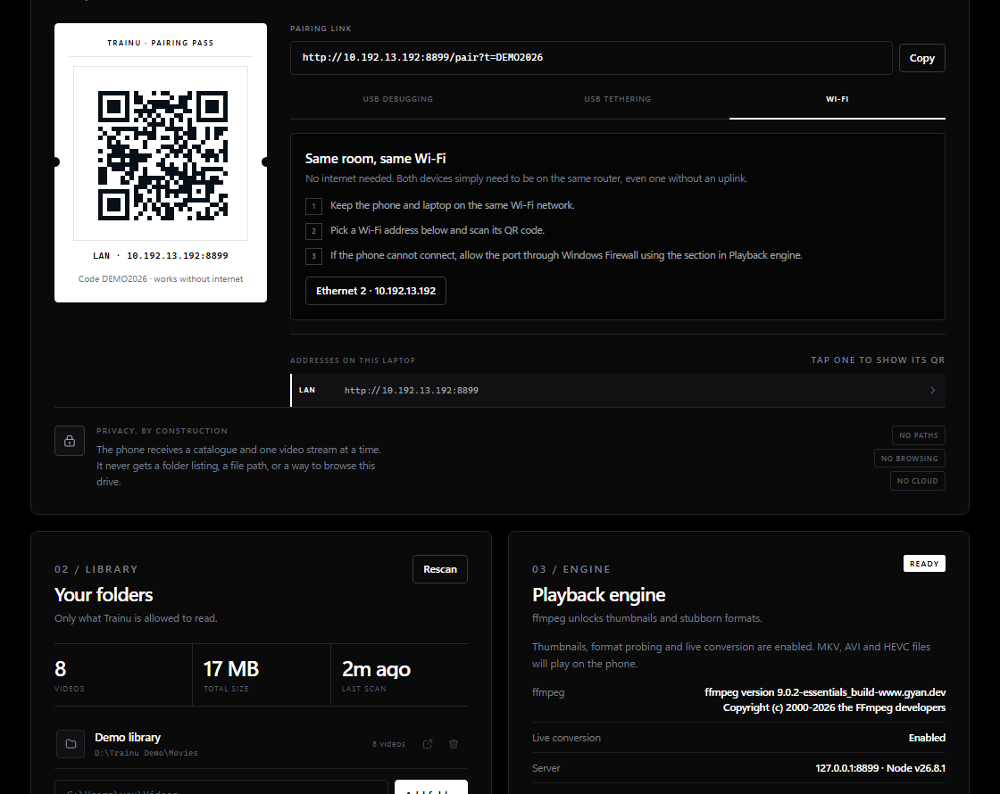
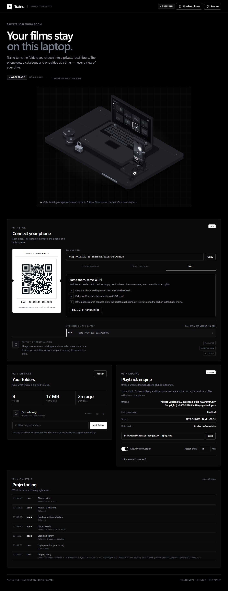

<p align="center">
  
</p>

<h1 align="center">Trainu</h1>

<p align="center">
  <strong>Your laptop's library. On your phone.</strong><br>
  Stream the video folders you already own over a USB cable or your own Wi-Fi.<br>
  No copying. No cloud. No accounts.
</p>

<p align="center">
  <a href="https://github.com/Abhishek-mee/trainu/actions/workflows/ci.yml"></a>
  <a href="LICENSE"></a>
  <a href="package.json"></a>
  <a href="package.json"></a>
  <a href="CONTRIBUTING.md"></a>
</p>

<p align="center">
  <a href="#quick-start">Quick start</a> ·
  <a href="#screenshots">Screenshots</a> ·
  <a href="#how-it-works">How it works</a> ·
  <a href="#privacy-and-security">Privacy</a> ·
  <a href="#faq">FAQ</a>
</p>

Trainu turns the video folders on your laptop into a private streaming library for your phone. The laptop reads the file from disk and sends its bytes over the link. Nothing is copied to the phone, uploaded, or sent through the internet.

- **Laptop app:** a small Node.js server plus a control panel on a separate loopback-only port. The phone link can never open the panel.
- **Phone app:** an installable web app (PWA) with a cinematic billboard, search, folders, resume positions, subtitles and a custom player.
- **Offline:** no accounts, no cloud, no telemetry, and no internet connection is required.
- **No dependencies:** only Node.js is needed. ffmpeg and adb are optional.

## Why Trainu

Most ways to watch your own library involve uploading it, running a media server exposed to the internet, or copying files to a phone that has no space left. Trainu takes the shortest path instead.

- **Your files never move.** Video stays in the folders you choose. The phone receives a catalogue and one stream at a time.
- **One cable, zero network.** USB debugging uses `adb reverse` to carry `localhost` over the cable. Wi-Fi and USB tethering work too, with no internet uplink.
- **A real player.** Seeking, resume, subtitles, 10-second skip, speed, PiP and fullscreen, backed by HTTP Range requests.
- **Bring your own formats.** MP4, WebM, MOV and more play directly. ffmpeg adds thumbnails, metadata and live conversion for MKV, AVI and HEVC.
- **Nothing to install on the server.** No npm install, no database, no Docker, no lockfile. Node.js 20+ and `npm start`.
- **Small enough to audit.** Plain ES modules, plain CSS, dependency-free browser scripts, 24 tests.

## Screenshots

The screenshots below use a synthetic demo library. No personal folders, filenames or tokens appear in them.

<table>
  <tr>
    <td align="center"></td>
    <td align="center"></td>
    <td align="center"></td>
  </tr>
  <tr>
    <td align="center"><sub>Billboard and resume</sub></td>
    <td align="center"><sub>Library and progress</sub></td>
    <td align="center"><sub>Pair once with a pass</sub></td>
  </tr>
</table>

<p align="center">
  
</p>

<p align="center">
  
</p>

<details>
<summary><strong>See the full laptop panel</strong></summary>
<br>

</details>

## Quick start

You need **Node.js 20 or newer**. There is no `npm install` step.

```bash
git clone https://github.com/Abhishek-mee/trainu.git
cd trainu
npm start
```

On Windows you can also double-click **`start-trainu.cmd`**.

1. The laptop control panel opens at a loopback address such as <http://127.0.0.1:8766/desktop>. The console prints the exact port; it is chosen fresh at each startup.
2. Under **Library**, add the folders that contain your videos.
3. Under **Connect your phone**, pick a connection method and scan the QR code with the phone camera.
4. The phone opens the library, already paired. Use the browser menu to install it on the home screen if you like.

If the phone port (8765) is busy, Trainu moves to the next free port and shows the real address in the panel. The panel keeps its own loopback port. The CLI equivalent is:

```powershell
node bin/trainu.mjs
```

## Connect your phone

### Option A — USB debugging (recommended, no network)

This uses `adb reverse` to carry `localhost:8765` over the cable. It is the most private option and works with Wi-Fi and mobile data turned off.

Requirements: Android phone, a USB cable, and Android platform-tools (`adb`) on the laptop. Trainu looks for `adb` on `PATH`, in the standard Android SDK folders, and in `tools\platform-tools\adb.exe` inside the project. You can also set `ADB_PATH` to the full path of `adb.exe`. The `tools\platform-tools\` folder is ignored by Git, so a portable copy is not committed.

1. On the phone, open **Settings → About phone** and tap **Build number** seven times.
2. In **Developer options**, enable **USB debugging**.
3. Plug in the cable. Pull down the USB notification and choose **File transfer** (not “Charging only”).
4. Unlock the phone. In the laptop panel, open the **USB debugging** tab and press **Connect phone**.
5. When **Allow USB debugging?** appears, tick **Always allow from this computer** and tap **Allow**. Trainu waits for this and finishes the link automatically.
6. Scan the localhost QR, or open `http://localhost:8765` on the phone. Do not open the panel address on the phone — it is not forwarded.

If the phone is already authorized, Android does not show the prompt again; **Connect phone** links it straight away. If the phone is unplugged, press **Connect phone** after reconnecting. `adb` is only needed for setup; the video stream never leaves the cable.

#### The USB debugging prompt does not appear

1. **Unlock the phone.** The dialog cannot appear over the lock screen.
2. **Choose File transfer** in the phone’s USB notification. “Charging only” hides adb.
3. On the phone, open **Developer options → Revoke USB debugging authorizations**, then unplug and replug the cable.
4. Turn **USB debugging** off and on again, then press **Connect phone** in the panel. It restarts the adb server so Android treats the laptop as a new authorization request and shows the prompt again.
5. Try another cable and a port directly on the laptop, not through a hub.
6. On Windows, if `adb devices` still shows nothing, install the phone maker’s USB driver. Xiaomi/HyperOS phones work with the standard Android USB driver; “USB debugging (Security settings)” is only needed for simulated input, not for Trainu.

The **Phone prompt not showing?** section in the panel repeats these steps. If `adb` is missing, the panel explains where to put `platform-tools`; USB tethering and Wi-Fi remain available without it.

### Option B — USB tethering (Android, no adb)

1. Connect the USB cable.
2. On Android, open **Settings → Hotspot & tethering** and enable **USB tethering**.
3. Wait for the laptop to show a new USB network, then scan the USB QR in the panel.
4. Turn mobile data off first if you want to be certain no internet is used. Trainu only needs the local USB network.

### Option C — Wi-Fi (works for iPhone and Android)

Both devices must be on the same router. The router does **not** need an internet connection.

1. Join the same Wi-Fi network on both devices.
2. In the panel, choose the **Wi-Fi** tab and scan the QR for the laptop's LAN address.
3. If the phone cannot connect, allow the port through the laptop firewall. The **Playback engine** panel shows the exact Windows command, and the server prints the address it is using at startup.

### iPhone and iPad

iOS does not expose its USB network to third-party apps, so **use Wi-Fi** on iPhone and iPad. USB tethering on iOS shares internet *to* the laptop; it does not create a usable USB link for Trainu. In Safari, use **Share → Add to Home Screen** to get a full-screen icon.

## Formats and ffmpeg

Without ffmpeg, Trainu direct-plays the formats phone browsers support:

- **Containers:** MP4, M4V, MOV, WebM, OGV
- **Video:** H.264, VP8, VP9, AV1
- **Audio:** AAC, MP3, Opus, Vorbis, FLAC

Trainu also indexes MKV, AVI, WMV, FLV, TS, M2TS, MPG, 3GP, ASF and VOB. Without ffmpeg those appear in the library but may fail to play. With ffmpeg, Trainu can:

- generate poster thumbnails;
- read duration, resolution and codecs through ffprobe;
- live-convert unsupported files to fragmented MP4 while you watch (up to two at once);
- remux compatible files without re-encoding.

Install ffmpeg and make sure `ffmpeg` is on `PATH` (on Windows, `winget install Gyan.FFmpeg` is one option), or enter the full path to `ffmpeg.exe` in the laptop panel and press **Save**. Trainu detects it at startup and immediately after saving. `ffprobe` is used when it sits next to ffmpeg.

For a portable setup, drop a Windows build into `tools\ffmpeg\bin\` (or a Unix build into `tools/ffmpeg/bin/`). Trainu checks that folder automatically, even when nothing is on `PATH` and no panel path is saved. The `tools/ffmpeg/` folder is ignored by Git; posters are generated on first view, and MKV/AVI/HEVC files are converted to fragmented MP4 on the fly with up to two conversions at once.

### Subtitles

Sidecar subtitles are picked up beside the video:

- `Movie.srt` or `Movie.en.srt`
- `Movie.vtt` or `Movie.en.vtt`

SRT is converted to WebVTT on the fly. The language suffix (`en`, `hi`, `ta`, …) becomes the track label. The player has a CC button and remembers whether subtitles were on.

## Install as an app

The phone UI is a PWA with a manifest, icons and a service worker. Browsers only allow service workers and install prompts in a **secure context**:

- `http://localhost:8765` through `adb reverse` — installable, with an offline app shell.
- HTTPS — installable, with an offline app shell.
- `http://192.168.x.x:8765` on Wi-Fi — the app works normally, but the browser will not install it as a PWA or cache the shell. Adding it to the home screen still creates a shortcut.

The offline shell only caches the interface. Video always comes from the laptop, so playback needs the link to be up.

## Privacy and security

- Video bytes travel directly between the laptop and the paired phone. There is no cloud service, upload, account or analytics.
- The control panel and admin API are served by a **separate HTTP listener bound to `127.0.0.1`**, on a port chosen at startup. The main phone listener redirects loopback browsers to that address and returns **403** to everyone else.
- `adb reverse` forwards only the phone port. Tunnelled phone requests look like loopback traffic to the main server, but the panel is on a different port, so the phone cannot reach it.
- The pairing page shows the panel address as `127.0.0.1:<admin port>/desktop` — an address that only resolves on the laptop itself.
- Other clients must present the random 8-character pairing token from the QR/link. A successful pairing sets an `HttpOnly`, `SameSite=Lax` cookie.
- Media URLs use hashed IDs. Filesystem paths are never returned in the phone library JSON, and the phone has no directory listing or arbitrary file access. Only indexed videos and their sidecars have a requestable address.
- Streaming is the design: the laptop reads the chosen file and sends its bytes over the link. Nothing is copied to the phone, and unindexed files have no URL.
- The pairing token is stored in the data folder (`config.json`). Anyone who knows the token, or has access to the laptop, can stream the library.
- There is no TLS on the LAN link. Use USB debugging/localhost for the strongest isolation, and use Trainu only on a network you trust.
- Watch progress is stored per phone browser cookie on the laptop.

Read [SECURITY.md](SECURITY.md) for the threat model and private reporting process.

## How it works

```text
┌─────────────────────┐        USB cable (adb reverse)        ┌──────────────────────┐
│  Phone PWA          │ ────────────────────────────────────▶ │  Node server         │
│  library · player   │        Wi-Fi / USB tethering          │  auth · ranges       │
└─────────────────────┘ ────────────────────────────────────▶ │  scanner · ffmpeg    │
                                                              └──────────┬───────────┘
                                                                         │ read-only
                                                              ┌──────────▼───────────┐
                                                              │  Your video folders  │
                                                              └──────────────────────┘
```

The phone listener and the admin listener are separate HTTP servers. The admin listener binds to `127.0.0.1` on an ephemeral port and is never forwarded by `adb reverse`. The phone gets a catalogue of hashed IDs; the server resolves an ID to a file only when that indexed media is requested.

Project layout:

- `bin/trainu.mjs` — CLI startup and shutdown
- `src/` — server, library scanner, media/ffmpeg tools, config, progress, USB helpers
- `public/` — phone UI, laptop panel, pairing page, PWA assets
- `test/` — integration and unit tests
- `scripts/make-icons.mjs` — dependency-free icon generator
- `scripts/iso-figure-kit.mjs` — projection and drawing helpers for the isometric figure
- `scripts/make-signal-figure.mjs` — builds `public/iso-local-link.svg`
- `docs/screenshots/` — privacy-safe demo screenshots
- `DESIGN.md` — phone and laptop design system

## Data and command line

By default, config, metadata, thumbnails and progress live in `.trainu/` inside this project. Use `--data` to put them elsewhere.

```text
trainu [options]

  --port <number>   Port to listen on (default 8765, 0 picks a free port)
  --host <address>  Interface to bind (default 0.0.0.0)
  --data <folder>   Where config, cache and watch progress live
  --no-open         Do not open the laptop control panel
  --help            Show help
  --version         Show the version
```

Examples:

```powershell
npm start
npm start -- --port 9000 --no-open
node bin/trainu.mjs --data D:\trainu-data
```

The data folder contains:

- `config.json` — library folders, port, paired token, settings;
- `meta.json` — probed metadata cache;
- `thumbs/` — generated JPEG posters;
- `progress.json` — per-device resume positions.

Deleting the data folder resets pairing and settings. Your video files are never touched.

## Troubleshooting

**The phone cannot open the page.**
Check that both devices are on the same link. For Wi-Fi, allow the port through Windows Firewall (the panel has a copyable command). For USB tethering, wait for the new network and press **Rescan** in the panel. For USB debugging, press **Connect phone** again and confirm the phone authorized the computer.

**The QR scans but the library stays empty.**
Add a folder in the laptop panel. Trainu rescans automatically; the **Rescan** button forces a fresh scan. Hidden and system folders are skipped.

**A video will not play.**
Try an MP4/WebM file first. MKV, AVI and HEVC need ffmpeg for live conversion. If ffmpeg is installed, confirm it appears as **Ready** in the panel and that **Allow live conversion** is on.

**Subtitles do not appear.**
Name the file after the video (`Movie.en.srt`) and keep it in the same folder. Only SRT and VTT sidecars are supported.

**The laptop sleeps or playback stops.**
Keep the laptop awake and the cable connected. Closing the lid pauses the stream.

**The phone still shows an old library.**
The phone caches the last library for offline display. Pull-to-refresh or press **Refresh library** in Settings; the laptop rescans every 10 minutes by default.

**I lost the pairing code.**
Open the control panel on the laptop. The code is also in `.trainu/config.json` (field `token`). Pair again from the panel.

**Connect phone says adb was not found.**
Put Android platform-tools in `tools\platform-tools\` inside the project, set `ADB_PATH` to the full path of `adb.exe`, or install Android Studio and let Trainu find the SDK copy. USB tethering and Wi-Fi do not need adb.

## FAQ

**Does Trainu upload anything?**
No. There is no cloud service, account, analytics or telemetry. The laptop reads the chosen file and streams it to the paired phone.

**Does it need an internet connection?**
No. The Wi-Fi router does not need an uplink, and the USB paths work with mobile data and Wi-Fi turned off. You only need the laptop and phone to be able to reach each other.

**Does it copy videos to the phone?**
No. The phone receives a catalogue and a stream. The original file stays in your folder, and unindexed files have no URL.

**Does it work on iPhone or iPad?**
Yes, over Wi-Fi. iOS does not expose a usable USB network to third-party apps. Add the page to the home screen from Safari.

**Can I use more than one phone?**
Yes. Each phone pairs with the same code and keeps its own resume position.

**What about 4K or HDR?**
Direct play passes the original bytes through, so quality depends on the phone browser's codec support. Live conversion is CPU-bound; a 4K HEVC file may not convert in real time on a laptop that cannot keep up. Try direct-play formats first.

**Is it safe on public Wi-Fi?**
Trainu has no TLS on the LAN link. Use USB debugging/localhost for the strongest isolation, and only run it on a network you trust. See [SECURITY.md](SECURITY.md).

**Why are there no npm dependencies?**
So the app can run offline, start with `node`, and stay small enough to read. The browser code is plain JavaScript and CSS; there is no bundler, framework or CDN.

**How do I update?**
Pull the latest code and restart Trainu. Your `.trainu/` data folder and video files are untouched.

**How do I reset pairing?**
Stop Trainu, remove `.trainu/config.json` (or the whole data folder) and restart. This resets pairing, settings and progress; your videos are not touched.

## Development

Node.js 20+ is the only prerequisite. There are no npm dependencies, install step, build step, linter or type checker.

```bash
npm test                                      # all tests (24)
node --test test/server.test.mjs              # integration tests only (15)
node --test test/units.test.mjs               # unit tests only (9)
node --test --test-name-pattern="watch progress" test/server.test.mjs
npm run icons                                 # regenerate PNG icons
npm run figure                                # regenerate the isometric figure
```

The integration tests start real HTTP servers on free ports with throwaway libraries. They cover byte ranges, pairing, auth, admin isolation, subtitles, progress, gzip, static assets and path traversal.

CI runs the suite on Node.js 20, 22 and 24, on Linux and Windows. The ffmpeg and real-`adb` paths are optional. The adb device parser and the prompt-wait state machine are unit-tested with a fake runner; a real phone is still needed to exercise the USB flow end to end.

Manual checks after UI or server changes:

- start on a free port with a throwaway data folder and open the **printed admin URL**;
- `/api/library` contains no `filePath`;
- the admin port refuses non-loopback clients and is not forwarded by `adb reverse`;
- unpaired remote requests get 401/403;
- the pair page shows the admin port and no placeholder text;
- an MKV plays through `/api/convert/<id>` with `X-Trainu-Mode: transcode`, and `/api/thumbnails/<id>.jpg` returns a JPEG;
- **Connect phone** shows the device model and **USB link active**, and `adb reverse --list` contains `tcp:8765`;
- an unauthorized phone shows the waiting state, then finishes automatically after **Allow** is tapped;
- **Phone prompt not showing?** is visible and explains File transfer, revoke, cable and HyperOS steps;
- phone views at 393×851, 360×800 and 320×800 have no horizontal overflow, and the panel holds together at 1120, 860 and 660 px.

## Contributing

Contributions are welcome, especially bug reports from phones and operating systems that are not covered yet.

- Read [CONTRIBUTING.md](CONTRIBUTING.md) for setup, tests and the invariants.
- Use the [bug report](https://github.com/Abhishek-mee/trainu/issues/new?template=bug_report.yml) or [feature request](https://github.com/Abhishek-mee/trainu/issues/new?template=feature_request.yml) form.
- For security issues, follow [SECURITY.md](SECURITY.md) and report privately.
- By participating, you agree to the [Code of Conduct](CODE_OF_CONDUCT.md).

## License

[MIT](LICENSE) © 2026 Abhishek-mee.

Trainu is an independent project. It is not affiliated with Netflix, and it does not include Netflix logos, wordmarks or assets.

---

<p align="center"><sub>If Trainu saves you a cloud upload, a star helps other people find it.</sub></p>
